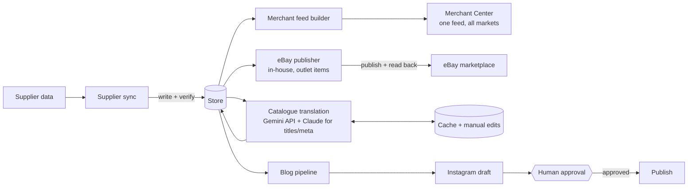

# AI e-commerce pipelines: a solo-founder case study

How I run a multi-market, multi-language online store as one person: a set of small, AI-assisted pipelines where every write is verified and every irreversible step passes a human approval gate.

## The problem

[Maison de Cocon](https://maisondecocon.com) is a quiet-luxury sleep and bedding brand. I run it alone, and it sells across **6 markets in 4 languages (DE/EN/FR/NL)**, with stock coming from several suppliers.

Done by hand, that means translating every product, keeping stock honest across suppliers, producing a feed for each market, and publishing content, all on a schedule. Done badly, it means silent failures: a sync that reports success while the shop is out of date, or an automation that overwrites a correction I made by hand.

The goal was not "automate everything". It was to automate the repeatable parts **and make failure loud**.

## Architecture

More detail: [docs/architecture.md](docs/architecture.md).

## Pipelines

| Pipeline | What it does | Schedule |
|---|---|---|
| Supplier sync | Pulls supplier product and stock data, writes it to the store, reads it back to verify. Built for a direct supplier integration | Daily (GitHub Actions) |
| Supplier onboarding | Takes a new supplier batch from bulk export to live listings: build batches, diff the product structure as a dry run, apply with an explicit `--write`, then read every field back to verify. Product copy may only use manufacturer-supplied text; unclear cases are flagged for my decision instead of guessed | On demand, per supplier batch |
| Merchant Center feed | One builder produces a single feed with an offer per product per market, including full image galleries | Scheduled (GitHub Actions) |
| eBay channel | In-house publisher for a second sales channel: builds eBay listings from store data and publishes them through eBay's Sell Inventory API (dry-run by default; the scheduled jobs pass an explicit apply flag). It keeps the single unit of each item from being sold twice: an eBay order lowers store stock, a store sale withdraws the eBay offer, and prices follow the store. Doubtful items (low-confidence category, price below a floor) are held and mailed to me instead of published. **Status: built and running for outlet (returned / open-box) items only, first live listing published in Nov 2026. Not extended to the main catalogue.** It is its own publisher, not an extra output of the Merchant Center feed builder, and uses no third-party multichannel tool | Hourly (orders, stock, price) and daily (publish, price) via GitHub Actions |
| Translation | Translates product copy from EN into DE/FR/NL via the Gemini API (free tier), with Claude for titles and meta fields. Provider history: DeepL, then Azure AI Translator, then Gemini. A cache keyed by content; manual edits are seeded into the cache so they always win | On demand, after catalogue changes; free-tier usage logged per run |
| Blog | Monthly research stage merged via pull request (my approval gate), then drafts posts Mon–Sat, translated into DE/EN/FR/NL, with AI-generated images | Monthly research + daily drafting |
| Social | Drafts German Instagram and Facebook posts for each new blog post (Pinterest being rolled out), then sends one combined approval email. Nothing is published until I approve, and every post is read back to verify. Nothing is ever posted automatically | Draft stage runs twice daily; publishing is manual only |
| Outreach | Researches link-building opportunities and prepares outreach pitches, across four jobs | Scheduled (GitHub Actions) |

### Planned pipelines

Next on the list, built on the same rules: verify every write, fail loudly, and keep a person in the loop for anything that can't be undone.

| Pipeline | What it will do | Schedule |
|---|---|---|
| Catalogue health | Checks every product for stock changes, missing data and broken listings, then updates the store and the channel feeds (Merchant Center, idealo) to match | Daily |
| Price & margin watch | Compares supplier costs with shop prices and flags any product that falls below its target margin before it sells at a loss | Daily |
| KPI digest | One weekly summary of sales, traffic, search and feed health, so problems show up in one place | Weekly |

## How I build with AI

- **Claude Code and the Claude API.** Claude Code writes and changes the pipelines. The Claude API does runtime language work: Instagram captions, blog drafting, and inline blog translation. Product catalogue translation splits the work: Claude writes product titles and SEO meta fields, where wording and length matter most, and the Gemini API translates the longer copy, behind a cache and a field allowlist.
- **PR approval gates.** Changes land through pull requests I review. Anything that publishes to the outside world (such as an Instagram post) has a separate manual approval step with no schedule attached.
- **Read-only diagnosis before writes.** When something looks wrong, the first pass only reads: find the cause, show the evidence, propose the fix. Writes come after I agree.
- **Verification after.** Every write is read back and compared. A run that cannot prove it worked fails.

## Translation provider history: DeepL → Azure AI Translator → Gemini API

Catalogue translation has had three providers. Each switch was small because the provider sits behind a stable interface and my own data (cache, manual edits, glossary) stays on my side.

| | DeepL API Free | Azure AI Translator (F0) | Gemini API (free tier) |
|---|---|---|---|
| Period | until Oct 2026 | Oct–Nov 2026 | from Nov 2026 |
| Free allowance | 1M characters, lifetime | 2M characters per month | Request limits per minute and per day, no character pool |
| Billing | none | none | none linked, so at the limit it stops instead of charging |
| Model | Dedicated MT | Dedicated MT | General LLM (`gemini-3.5-flash-lite`) |

**DeepL → Azure (Oct 2026).** DeepL's free plan has a 1M-character *lifetime* limit and the catalogue had used about 90% of it. I compared real DE/FR/NL product copy side by side and switched. A monthly scheduled check tracked Azure usage.

**Azure → Gemini (Nov 2026).** Glossary terms found in each text are listed in the request as hints. The trade-off of a general model is that it needs more guard rails than a dedicated translator, so the design below puts them in code. Free-tier content may be used by the provider to improve its products. Product copy is public anyway, but nothing confidential goes through this route.

### Design of the Gemini provider

- **Provider behind a stable interface.** The rest of the pipeline calls one translation interface. The provider is selected by configuration and the model ID comes from configuration with no default, so a model change is a config change.
- **Batched, structured requests.** Strings are grouped (at most 15 texts or about 8k characters per request) and the model must answer in a fixed JSON shape, one entry per input id. A malformed or incomplete answer is rejected, never half-applied.
- **Throttled and resilient.** Requests are throttled to the model's per-minute limit. A per-minute rate-limit response is retried with exponential backoff (or the server's suggested delay). An authentication failure is never retried.
- **Resume-safe on the daily quota.** The cache is written after every field. When the daily quota runs out the run stops cleanly with a distinct exit code, and the same command rerun after the reset continues from cache hits.
- **Length-range validation.** For fields with a length rule the allowed range is part of the request. An out-of-range answer is retried once with the measured length fed back; if it is still out of range the field is flagged for manual review. No further automatic rewriting.
- **Provider-agnostic cache.** The cache key (`locale:field:text`, plus a glossary version tag) does not include the provider, so existing translations were reused after each switch, and manual edits still always win.
- **Claude where wording matters most.** Product titles and SEO titles and meta descriptions still go to Claude, with length and content rules enforced in code.
- **Cost and quota visibility.** Each run appends its request, character and token counts to a local usage log, so limits show up before they are hit.

**The point.** Because the translator sits behind its own small interface, changing provider twice was a configuration change plus a new adapter, not a rebuild.

## Examples

Simplified rewrites with invented data, standard library only (Python 3.10+):

| Example | Idea | Run |
|---|---|---|
| [translation](examples/translation/) | Cache keyed by `locale:field:text`; manual edits are seeded into the cache so automation never overwrites them | `python examples/translation/translate.py` |
| [merchant-feed](examples/merchant-feed/) | One feed builder serves every market from a config table | `python examples/merchant-feed/build_feed.py` |
| [inventory-sync](examples/inventory-sync/) | Daily sync that reads back every write; any mismatch exits non-zero | `python examples/inventory-sync/sync.py` |

Add `--simulate-silent-drop` to the inventory sync to watch it catch a store that accepts a write and ignores it. The [example workflow](.github/workflows/example-daily-sync.yml) shows how that failure surfaces as a red check.

## Outcomes

- **6 markets, 4 languages (DE/EN/FR/NL)** run by one person.
- **~870 offers in one feed**, built by a single feed builder.
- **Layout shift (CLS) 0.127 → 0.001** on the storefront.

## Lessons learned

1. **Silent failures are the real enemy.** An API that returns 200 has only accepted the request. Verify the write by reading it back, and fail the run if it doesn't match.
2. **Protect human edits.** If automation can overwrite a correction, people stop correcting. Manual edits live in the same cache and always win.
3. **Make cost a design decision.** Cache by content so unchanged text is never sent to the translator twice, translate only an allowlist of fields, and prefer free tiers until a paid one is justified.
4. **Keep approval gates where actions can't be undone.** Drafting is automatic; publishing is a person pressing a button.
5. **Keep vendors swappable.** Put external services behind a thin interface and keep your own data (cache, edits) on your side. When DeepL's free limit ran out, moving to Azure took a provider switch, not a rewrite. The same interface made the later move to Gemini an adapter, not a rewrite.
6. **Don't depend on a paid third-party hub for a new channel.** A second sales channel (eBay) is a small in-house publisher with the same rules as everything else: dry-run first, verify after, hold doubtful items for a person.

More: [docs/decisions.md](docs/decisions.md).

---

*Production code is private; examples are simplified with sample data.*
