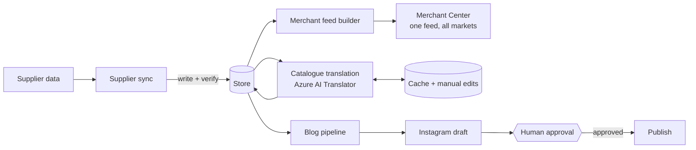

# AI e-commerce pipelines: a solo-founder case study

How I run a multi-market, multi-language online store as one person: a set of small, AI-assisted pipelines where every write is verified and every irreversible step passes a human approval gate.

## The problem

[Maison de Cocon](https://maisondecocon.com) is a quiet-luxury sleep and bedding brand. I run it alone, and it sells across **6 markets in 4 languages (DE/EN/FR/NL)**, with stock coming from several suppliers.

Done by hand, that means translating every product, keeping stock honest across suppliers, producing a feed for each market, and publishing content, all on a schedule. Done badly, it means silent failures: a sync that reports success while the shop is out of date, or an automation that overwrites a correction I made by hand.

The goal was not "automate everything". It was to automate the repeatable parts **and make failure loud**.

## Architecture

More detail: [docs/architecture.md](docs/architecture.md).

## Pipelines

| Pipeline | What it does | Schedule |
|---|---|---|
| Supplier sync | Pulls supplier product and stock data, writes it to the store, reads it back to verify. Built for a direct supplier integration | Daily (GitHub Actions) |
| Merchant Center feed | One builder produces a single feed with an offer per product per market, including full image galleries | Scheduled (GitHub Actions) |
| Translation | Translates product copy from EN into DE/FR/NL via Azure AI Translator (DeepL until Oct 2026), with a cache keyed by content; manual edits are seeded into the cache so they always win | On demand, after catalogue changes; usage checked monthly |
| Blog | Monthly research stage merged via pull request (my approval gate), then drafts posts Mon–Sat, translated into DE/EN/FR/NL, with AI-generated images | Monthly research + daily drafting |
| Instagram | Drafts a caption and image for each new blog post, then waits for my approval to publish | Draft stage runs twice daily; publishing is manual only |
| Outreach | Researches link-building opportunities and prepares outreach pitches, across four jobs | Scheduled (GitHub Actions) |

### Planned pipelines

Next on the list, built on the same rules: verify every write, fail loudly, and keep a person in the loop for anything that can't be undone.

| Pipeline | What it will do | Schedule |
|---|---|---|
| Catalogue health | Checks every product for stock changes, missing data and broken listings, then updates the store and the channel feeds (Merchant Center, idealo) to match | Daily |
| Price & margin watch | Compares supplier costs with shop prices and flags any product that falls below its target margin before it sells at a loss | Daily |
| KPI digest | One weekly summary of sales, traffic, search and feed health, so problems show up in one place | Weekly |
| Social expansion | Extends the Instagram pipeline to Pinterest, Facebook and Reddit, with drafts adapted per channel and the same human approval before anything is posted | With each new blog post |

## How I build with AI

- **Claude Code and the Claude API.** Claude Code writes and changes the pipelines. The Claude API does runtime language work: Instagram captions, blog drafting, and inline blog translation. Product catalogue translation is a different tool for a different job: Azure AI Translator, behind a cache and a field allowlist.
- **PR approval gates.** Changes land through pull requests I review. Anything that publishes to the outside world (such as an Instagram post) has a separate manual approval step with no schedule attached.
- **Read-only diagnosis before writes.** When something looks wrong, the first pass only reads: find the cause, show the evidence, propose the fix. Writes come after I agree.
- **Verification after.** Every write is read back and compared. A run that cannot prove it worked fails.

## Swapping DeepL for Azure AI Translator

In October 2026 I moved catalogue translation from DeepL to Azure AI Translator.

**Why.** DeepL's free API plan has a 1M-character *lifetime* limit, and the catalogue had used about 90% of it. I wanted a free option with the same quality, not a new monthly bill.

| | DeepL API Free | Azure AI Translator (F0) |
|---|---|---|
| Free allowance | 1M characters, lifetime | 2M characters, every month |
| Hosting | EU | EU (Germany West Central) |
| Quality on my DE/FR/NL product copy | Strong | On par in a side-by-side check |

**How.** I compared real product copy in DE/FR/NL side by side, then switched the provider. Nothing else changed: the cache, the field allowlist and the manual-edit protection stayed as they were, so text that was already translated was never sent again. A monthly scheduled check now tracks Azure usage, so the limit can't catch me by surprise.

**The point.** Because the translator sits behind its own small interface, changing provider was a configuration change, not a rebuild.

## Examples

Simplified rewrites with invented data, standard library only (Python 3.10+):

| Example | Idea | Run |
|---|---|---|
| [translation](examples/translation/) | Cache keyed by `locale:field:text`; manual edits are seeded into the cache so automation never overwrites them | `python examples/translation/translate.py` |
| [merchant-feed](examples/merchant-feed/) | One feed builder serves every market from a config table | `python examples/merchant-feed/build_feed.py` |
| [inventory-sync](examples/inventory-sync/) | Daily sync that reads back every write; any mismatch exits non-zero | `python examples/inventory-sync/sync.py` |

Add `--simulate-silent-drop` to the inventory sync to watch it catch a store that accepts a write and ignores it. The [example workflow](.github/workflows/example-daily-sync.yml) shows how that failure surfaces as a red check.

## Outcomes

- **6 markets, 4 languages (DE/EN/FR/NL)** run by one person.
- **~870 offers in one feed**, built by a single feed builder.
- **Layout shift (CLS) 0.127 → 0.001** on the storefront.

## Lessons learned

1. **Silent failures are the real enemy.** An API that returns 200 has only accepted the request. Verify the write by reading it back, and fail the run if it doesn't match.
2. **Protect human edits.** If automation can overwrite a correction, people stop correcting. Manual edits live in the same cache and always win.
3. **Make cost a design decision.** Cache by content so unchanged text is never sent to the translator twice, translate only an allowlist of fields, and prefer free tiers until a paid one is justified.
4. **Keep approval gates where actions can't be undone.** Drafting is automatic; publishing is a person pressing a button.
5. **Keep vendors swappable.** Put external services behind a thin interface and keep your own data (cache, edits) on your side. When DeepL's free limit ran out, moving to Azure took a provider switch, not a rewrite.

More: [docs/decisions.md](docs/decisions.md).

---

*Production code is private; examples are simplified with sample data.*
