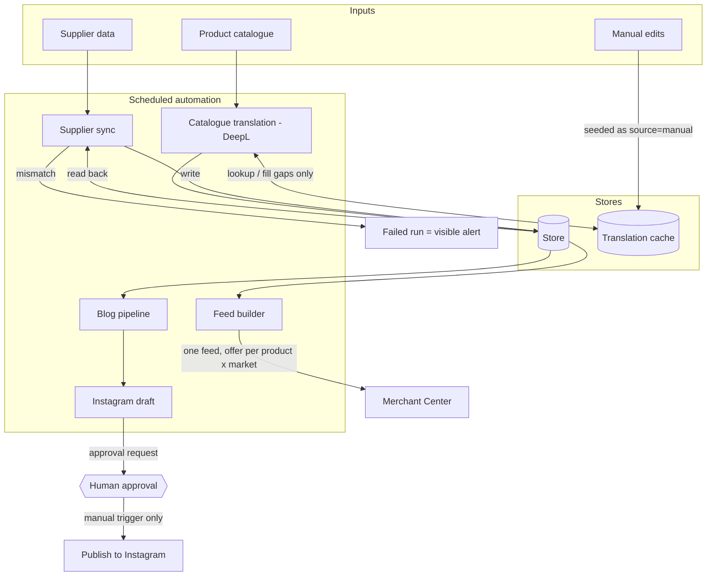

# Architecture

Small pipelines around one store, each with a single job. They share three rules: **diff before writing, verify after writing, and put a person in front of anything irreversible.**

## Reading the diagram

- **Supplier sync** compares supplier data with the store, writes only differences, then reads every changed value back. A mismatch fails the run.
- **Catalogue translation** (DeepL, allowlisted fields only) looks up `locale:field:text` in the cache. A hit is reused; a miss is translated and stored as `auto`. Entries marked `manual` are never replaced.
- **Feed builder** reads the store once and emits one offer per product per market, with full image galleries. Per-market differences (language, currency, URL prefix) live in a config table.
- **Blog** runs a monthly research stage that is merged by pull request (my approval gate), then drafts posts daily. Claude drafts and translates the posts inline; AI-generated images accompany them.
- **Instagram** is a two-stage flow. The draft stage runs on a schedule and creates an unpublished post plus an approval request. The publish stage has no schedule: it runs only when I trigger it.
