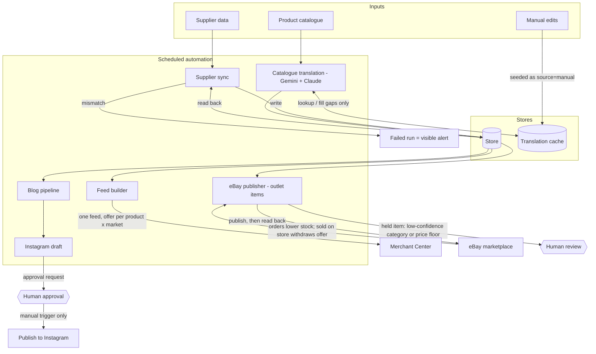

# Architecture

Small pipelines around one store, each with a single job. They share three rules: **diff before writing, verify after writing, and put a person in front of anything irreversible.**

## Reading the diagram

- **Supplier sync** compares supplier data with the store, writes only differences, then reads every changed value back. A mismatch fails the run.
- **Catalogue translation** (allowlisted fields only) looks up `locale:field:text` in the cache. A hit is reused; a miss is translated and stored as `auto`. Entries marked `manual` are never replaced. Product titles and SEO meta fields go to Claude; everything else goes to the Gemini API through a provider interface: batched structured-JSON requests, per-minute throttling with backoff, a clean resume-safe stop on the daily quota, and length-range validation that flags a field for manual review after one retry. The cache key does not name the provider, so a provider change reuses existing translations. The earlier providers were DeepL and Azure AI Translator.
- **Feed builder** reads the store once and emits one offer per product per market, with full image galleries. Per-market differences (language, currency, URL prefix) live in a config table.
- **eBay publisher** is an in-house, per-channel publisher that talks to eBay's Sell Inventory API. It is dry-run by default. The store stays the source of truth: an eBay order lowers store stock, a sale in the store withdraws the eBay offer, and prices follow the store, so the single unit of an outlet item is never sold twice. Items it is unsure about (low-confidence category, price below a floor) are held for review. **Status:** built and running for outlet (returned / open-box) items only; it is not wired into the Merchant Center feed builder and does not cover the main catalogue yet.
- **Blog** runs a monthly research stage that is merged by pull request (my approval gate), then drafts posts daily. Claude drafts and translates the posts inline; AI-generated images accompany them.
- **Instagram** is a two-stage flow. The draft stage runs on a schedule and creates an unpublished post plus an approval request. The publish stage has no schedule: it runs only when I trigger it.
